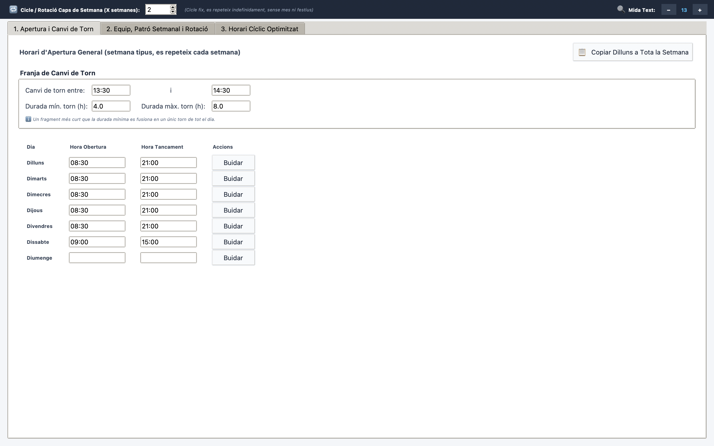
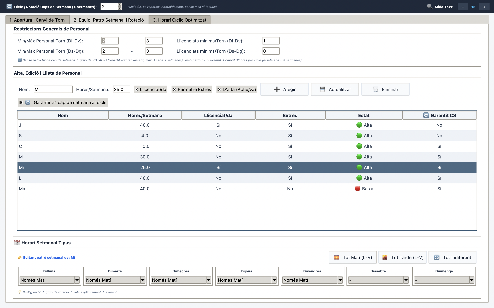
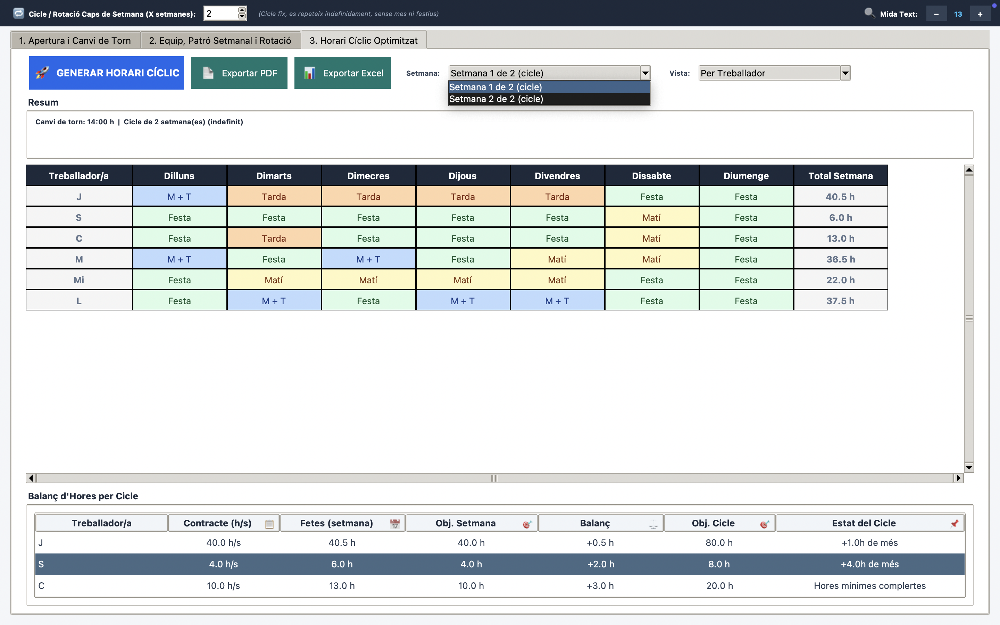
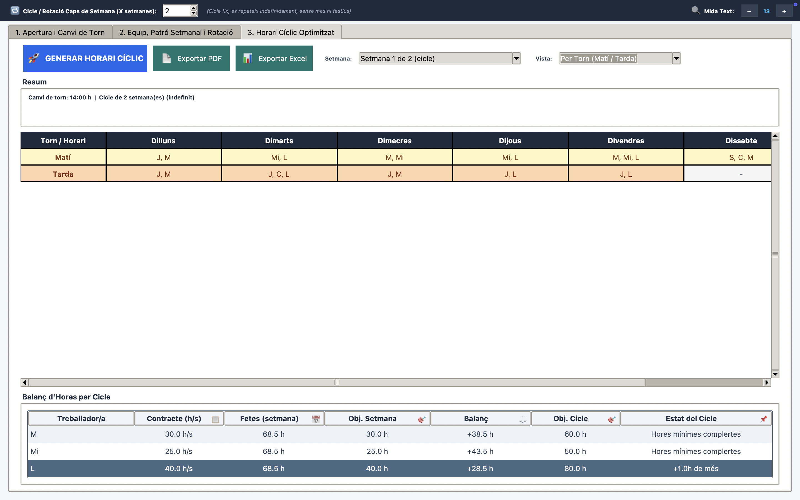
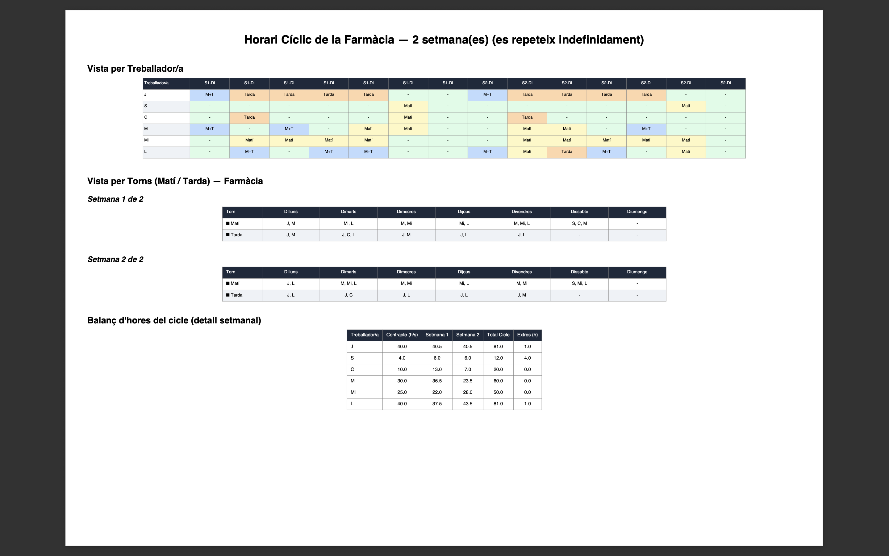
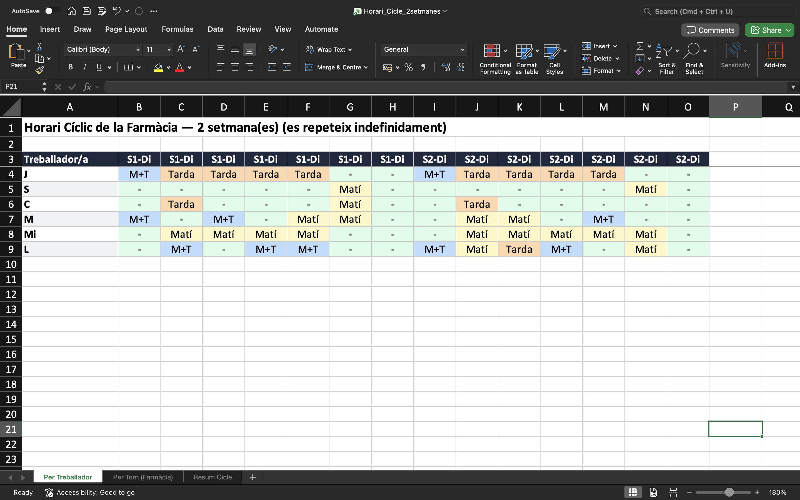

# Pharmacy Cyclic Scheduler

Cross-platform desktop application (Python + Tkinter) that generates fair, optimized cyclic work schedules for pharmacy staff. Shifts are assigned with integer linear programming (PuLP), and the result can be exported to PDF and Excel.


## Table of contents

- [Overview](#overview)
- [Screenshots](#screenshots)
- [Features](#features)
- [Requirements](#requirements)
- [Installation](#installation)
- [Usage](#usage)
- [Project structure](#project-structure)
- [Data format](#data-format)
- [Tech stack](#tech-stack)
- [Roadmap](#roadmap)
- [Contributing](#contributing)
- [License](#license)
- [Author](#author)

## Overview

The app builds a repeating N-week schedule for a pharmacy team, taking into account:

- Contracted hours and availability of each employee
- Weekly patterns (morning only, afternoon only, preferred shift, days off, etc.)
- Minimum and maximum staff per shift (weekdays and weekends configured separately)
- A minimum number of licensed pharmacists per shift
- Fair rotation of weekends across the team, with optional guaranteed weekends per cycle

If the constraints cannot be satisfied, the app explains which ones are the problem (for example, a worker whose contracted hours are unreachable with their weekly pattern).

## Screenshots

### Setup

| Opening hours & shift change | Team & weekly pattern |
|---|---|
|  |  |

### Generated schedule

| By worker | By shift (morning / afternoon) |
|---|---|
|  |  |

### Export

| PDF | Excel |
|---|---|
|  |  |

More Excel sheets: [by shift](docs/08-excel-by-shift.png) | [cycle summary](docs/09-excel-summary.png)

> The screenshots use fictional, anonymized staff data.

## Features

- Three-tab GUI: opening hours and shift change, team and weekly pattern, optimized schedule
- Optimization engine based on PuLP (CBC solver bundled with PuLP)
- Cyclic schedule of 1 to 8 weeks that repeats indefinitely
- Two views of the result: by worker and by shift (morning / afternoon)
- Hours balance per worker and per cycle
- Export to PDF (ReportLab) and Excel (openpyxl)
- Data saved automatically to a local JSON file
- Runs on Windows, macOS and Linux (emoji icons fall back gracefully if no emoji font is found)

## Requirements

- Python 3.10 or newer
- A desktop environment (Tkinter needs a display)
- The packages listed in `requirements.txt`

## Installation

```bash
git clone https://github.com/nil-gascon/Pharmacy_cyclic_scheduler.git
cd Pharmacy_cyclic_scheduler
python3 -m venv venv
source venv/bin/activate        # Linux / macOS
venv\Scripts\activate           # Windows
pip install -r requirements.txt
cp dades_farmacia.example.json dades_farmacia.json
```

On Windows (PowerShell or cmd) use `copy dades_farmacia.example.json dades_farmacia.json` instead of `cp`.

## Usage

```bash
python3 HorarisFarmacia_ciclic.py
```

1. **Opening hours & shift change:** set the opening and closing time of each day and the shift-change window.
2. **Team & weekly pattern:** add employees, their weekly hours, whether they are licensed pharmacists, and their weekly pattern.
3. **Optimized schedule:** click *Generar Horari Cíclic*, browse the result by week and view, and export it to PDF or Excel.

Your data is saved automatically to `dades_farmacia.json` when you close the app.

> The user interface and the internal shift/pattern values are in Catalan (for example `Matí`, `Tarda`, `Festa`). A full English interface is planned.

## Project structure

```
.
├── HorarisFarmacia_ciclic.py        # Application (GUI + optimizer + export)
├── dades_farmacia.example.json      # Example data with fictional staff
├── requirements.txt
├── docs/                            # Screenshots used in this README
├── README.md
├── LICENSE
└── .gitignore
```

## Data format

`dades_farmacia.json` has three sections:

- `treballadors` (workers): weekly hours, licensed or not, overtime allowed, active or not, guaranteed weekend, and weekly pattern
- `config`: staffing limits, cycle length, shift-change window, shift duration limits and font size
- `horaris` (opening hours): start and end time for each day of the week

> **Privacy:** the real `dades_farmacia.json` is listed in `.gitignore` and is never committed. Only the example file with fictional data is part of the repository.

## Tech stack

| Component | Purpose |
|---|---|
| Tkinter | Desktop GUI |
| PuLP | Integer linear programming to assign shifts |
| Pillow | Emoji icon rendering |
| ReportLab | PDF export |
| openpyxl | Excel export |

## Roadmap

- [ ] Fully English user interface (with migration of existing data files)
- [ ] Automated tests for the optimization engine
- [ ] Split the code into modules (UI, optimizer, export)
- [ ] Standalone builds with PyInstaller

## Contributing

Suggestions and pull requests are welcome.

1. Fork the repository
2. Create a branch: `git checkout -b feature/my-feature`
3. Commit your changes: `git commit -m "Add my feature"`
4. Push the branch: `git push origin feature/my-feature`
5. Open a Pull Request

## License

Distributed under the MIT License. See [LICENSE](LICENSE) for details.

## Author

Built by Nil Gascón as a personal project.
